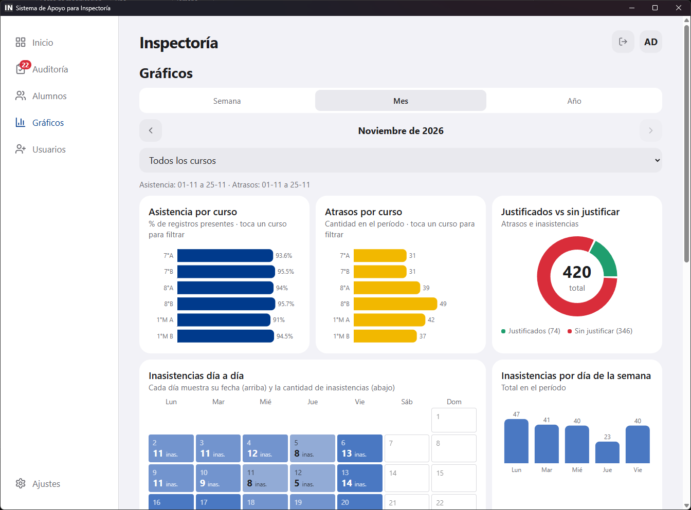

# SistemaApoyoInspectoria
Sistema de Apoyo para la auditoria y registro de justificaciones para la asistencia de los alumnos.

- Implementacion de Playwright para la extraccion de datos desde el portal institucional.
- Diferentes vistas para el analisis de la asitencia y atrasos de los alumnos.
- Vista de Auditoria para facilitar la identitifacion de patrones que podrian afectar a la convivencia escolar.

## instrucciones para crear el ejecutable portable windows y linux.

1. cd desktop

2. npm install

3. npm run dist

Esto generara nuevas carpetas, .\SistemaApoyoInspectoria\desktop\release\Apoyo Inspectoria Setup 1.X.X.exe

Aqui se guardan los datos y el instalador del sistema. 