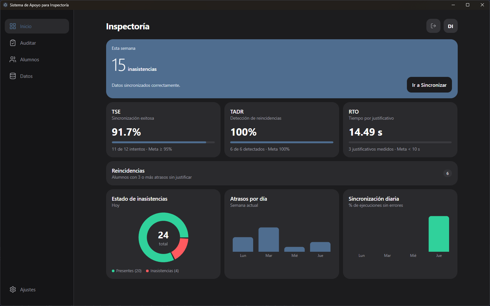

# SistemaApoyoInspectoria
Sistema de Apoyo para la auditoria y registro de justificaciones para la asistencia de los alumnos

## instrucciones para crear el ejecutable portable windows y linux.

1. cd desktop

2. npm install

3. npm run pack

esto generara nuevas carpetas, en la llamada "release" se guardan los datos y el archivo ejecutable del sistema. 